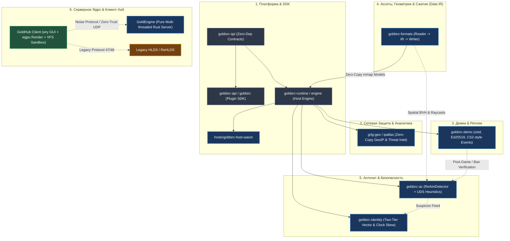

# GoldSrc.rs Ecosystem: Strategic Vision & Architectural Blueprint

> **Status:** Strategic Architecture Specification  
> **Target Version Horizon:** v0.20.0 — v2.0.0  
> **Philosophy:** Zero-Trust, Zero-Hardcode, Micro-kernel Isolation, Multi-Threaded Performance, Mechanical Sympathy (Scrooge Systems Mindset).

---

## Executive Overview

Экосистема **GoldSrc.rs** эволюционирует из модульного рантайма расширений в **целостную высокопроизводительную технологическую платформу нового поколения** для игр семейства GoldSrc (Half-Life, Counter-Strike 1.6, Team Fortress Classic, Day of Defeat).

Архитектура платформы разделена на **7 ортогональных взаимосвязанных слоев**:
1. **`GoldSrc Platform & SDK`** — модульный хост-рантайм (`goldsrc-runtime`), Wasm Component Model хостинг, чистые SPI-контракты (`goldsrc-spi`) и изолированный гостевой SDK (`goldsrc-api`, `goldsrc`).
2. **`Network Intelligence (grlg-geo / ipatlas)`** — суб-микросекундная zero-copy GeoIP и Proxy/VPN база данных (`mmap`, 1D Interval Sweep) для фильтрации датацентров, ботнетов и спама на уровне коннекта.
3. **`Next-Gen Demo Subsystem (goldsrc-demo)`** — событийно-ориентированный контейнер демок (zstd-сжатие, Ed25519-подпись, CS2-подобные маркеры раундов/киллов, стриминг клиент $\leftrightarrow$ сервер).
4. **`Behavioral Anti-Cheat Engine (goldsrc-ac)`** — гибридный детектор аима и перемещения: серверные 3D-матрицы хитбоксов (ReAimDetector) + временные сигнатуры ввода (UnrealDemoScanner) + адаптивный механизм внимания (Deep-Scan Lock-in).
5. **`GoldSrc Trust & Identity`** — двухуровневая векторная система доверия (`Network`, `Devices`, `Hardware`), физический дрейф кварца (`Clock Skew`), микроархитектурные тайминги CPU/GPU, аудио-фингерпринтинг и матрица политик (переезд, компьютерный клуб, спуфинг).
6. **`Asset Architecture & Spatial Data (goldsrc-formats)`** — чистая модель данных в памяти (Data IR / MIR), адаптеры `Reader` $\to$ `IR` $\to$ `Writer` без комбинаторного взрыва $O(N \times M)$, zero-copy `mmap` хранение в стиле `IPAtlas`, алгоритмический пайплайн (миграция `skybox-lift`) и zero-parsing пространственные рейкасты для античита.
7. **`GoldEngine & GoldHub Client`** — чистый многопоточный сервер на Rust (Tokio UDP + Rayon физика) и единый клиент-хаб нового поколения (GUI-оболочка на `wry` + современный 3D-рендер на `wgpu` + изолированная песочница VFS).

---

## Проект 1: GoldSrc Platform & SDK

### 1.1. Модульная декомпозиция (SMA & CQS)
* **`goldsrc-spi` (Pure Contracts)**:
  - Изолированные интерфейсы без тяжёлых зависимостей: `Engine`, `EngineExtension`, `AuthProvider`, `StorageProvider`, `TransportBackend`, `NetworkFilter`.
* **`goldsrc-api` / `goldsrc` (Pure SDK)**:
  - Полная поддержка `wasm32-wasip1`. Нулевые нативные зависимости (без компиляторов C++, без SQLite, без Wasmtime в коде плагина).
* **`goldsrc-runtime` (Host Container)**:
  - Лаконичная структура каталогов: `engine/` (ядро хоста), `backends/`, `hosts/`, `services/`, `extensions/`.
  - Загрузка модулей через Wasmtime Component Model с поддержкой изоляции памяти.
* **`TransportBackend`**:
  - `MetamodBackend`: C-ABI адаптер под Metamod (совместно с `goldsrc-extension-metamod`).
  - `StandaloneBackend`: C-ABI адаптер прямой подмены `cs.dll`.
  - `NativeServerBackend`: точка интеграции с чистым серверным ядром `GoldEngine`.
  - `HeadlessTestBackend`: детерминированный мок-бэкенд для e2e-тестирования плагинов на CI без запуска процесса HLDS.

---

## Проект 2: Сетевая защита и фильтрация трафика (`grlg-geo` / `ipatlas`)

### 2.1. Standalone-экосистема базы данных
* Независимый открытый репозиторий [ulquiorracode/ipatlas](https://github.com/ulquiorracode/ipatlas) (ранее `grlg-geo`).
* 1D Interval Sweep потоковый компилятор: объединение Geolocation (DB5) и Proxy/Threat Intelligence (PX10) в непрерывные интервалы с дедупликацией строковых пулов (сжатие 775 МБ CSV $\to$ 43.8 МБ `.gz`, 17.7x).
* Zero-Copy `mmap` Reader: поиск IP-диапазона за $< 70\text{ нс}$ в L1 кэше (до 205 нс в холодном DRAM) с нулевыми аллокациями.
* Битовые флаги угроз на коннекте: мгновенная проверка `is_datacenter`, `is_proxy`, `is_botnet`, `is_spam` при `ClientConnect`.

---

## Проект 3: Next-Gen Demo Subsystem (`goldsrc-demo`)

### 3.1. CS2-подобный контейнер нового поколения
* **Событийно-ориентированная структура**:
  - Точные маркеры раундов (`RoundStart`, `RoundEnd`, `FreezePeriodEnd`).
  - События экономики и инвентаря (закупки, сбросы оружия, установка/обезвреживание C4).
  - Killfeed и урон с sub-tick таймингами и мировыми 3D-координатами.
* **Lossless Zstandard Сжатие**: сжатие сетевого потока на лету через `zstd` (сокращение размера с 20–30 МБ до 4–7 МБ без потерь данных).
* **Криптографическая верификация (Ed25519)**: цифровая подпись заголовка и ключевых кадров сервером — демку невозможно модифицировать без нарушения целостности.
* **Двусторонний фоновый стриминг**: прямая передача демки от клиента серверу при бане или репорте для независимого арбитража.
* **100% обратная совместимость**: полезная нагрузка декодируется в стандартный Half-Life Demo Protocol (совместимость с UnrealDemoScanner и стандартными плеерами).

---

## Проект 4: Поведенческий Античит (`goldsrc-ac`)

### 4.1. Гибридный синтез (ReAimDetector + UnrealDemoScanner)
1. **Серверные 3D-матрицы хитбоксов (ReAimDetector)**:
   - Расчёт положения костей и хитбоксов в мировых координатах с учётом лагкомпенсации (`sv_unlag`).
   - Трассировка лучей выстрела в реальном 3D-пространстве (углы до центра костей и граней хитбокса).
2. **Временные сигнатуры инпута (UnrealDemoScanner)**:
   - **ViewAngle GCD / Pitch-Yaw Precision**: дискретность сенсора мыши ($m\_yaw/m\_pitch$) против неестественных float-значений чит-программ.
   - **Angular Acceleration & Jerk Curvature**: колоколообразный разгон/торможение руки человека против линейной интерполяции аима.
   - **PunchAngle RCS Compensation**: реакция на серверную отдачу без физиологической задержки человека ($< 15$ мс).
   - **Sub-tick Button Timing**: детекция нулевой дисперсии нажатий `IN_JUMP` (Bhop) и `IN_ATTACK` (FastZoom / KnifeBot).

### 4.2. Адаптивный механизм внимания (Deep-Scan Lock-in)
* **Lightweight Triage (Тир 1)**: для 95% проверенных игроков выполняются только быстрые $O(1)$ проверки. Нагрузка на сервер пренебрежимо мала.
* **Suspicion Accumulator (Leaky Bucket)**: при аномальных фликах уровень подозрительности растет.
* **Deep-Scan Lock-in (Тир 2)**: при превышении порога активируется глубокий перехват (полные матрицы хитбоксов, пространственные лучи, sub-tick дисперсия). Режим активен до тех пор, пока экспоненциальное затухание не подтвердит легитность игры на длинной дистанции.

---

## Проект 5: GoldSrc Trust & Identity (Двухуровневый вектор и физический фингерпринтинг)

### 5.1. Двухуровневая архитектура нечёткой уверенности ($[0.0, 1.0]$)
Заменяет устаревшие эмуляторы `RevEmu`/`Avatara` и генерацию `STEAM_0:0:...` по хэшу диска.
* **Уровень 1 (L1) — Группы**:
  - `Hardware` (Железо) — вес **0.55**.
  - `Network` (Сеть) — вес **0.25**.
  - `Devices` (Периферия и цифровые маркеры) — вес **0.20**.
* **Уровень 2 (L2) — Атрибуты и строгое ограничение конфигов**:
  - Конфиги игрока (`config.cfg`, квары, рейты) дают лавину ложных совпадений у 99% честных игроков. **Вес конфигов жёстко ограничен $\le 0.01$ (1%)**.

### 5.2. Физические методы без возможности софтверного спуфинга
1. **Аппаратный Clock Skew (Дрейф кварцевого генератора)** — *работает на Ваниле*:
   - Физический кварц материнской платы имеет температурный и производственный дрейф $\sim 10^{-6}$ (наносекунды в секунду).
   - Сервер `goldsrc-runtime` измеряет расхождение монотонных часов сервера и клиентских меток времени в `usercmd_t`. Наклон прямой (например, $+12.4$ нс/с) уникален для материнской платы и не сбрасывается сменой IP, переустановкой ОС или спуферами дисков.
2. **GPU Silicon Anomalies (Кремниевые дефекты чипа GPU)** — *в клиенте*:
   - Внеэкранный рендер 1 кадра со сложным шейдером трансцендентных функций ($\sin, \cos$ высокой точности). Различия литографии кристалла дают уникальные отклонения в младших битах мантиссы `float`.
3. **CPU RDTSC Side-Channels (Тайминги кэша)** — *в клиенте*:
   - Замер задержек кэш-линий L1/L2/L3 и TLB в процессорных тактах через `rdtsc`. Никакой HWID-спуфер не может изменить физическую скорость доступа кэша CPU.
4. **Аудио DSP / Inaudible Pulse (Звуковой тракт)** — *в клиенте*:
   - Генерация неслышимого технического импульса с нулевой громкостью. Анализ различий DSP-фильтров, ресемплинга и округлений FPU звуковой карты.
5. **TCP/IP Passive OS FP & UDP Jitter** — *на сервере под Ванилу*:
   - Анализ начального SYN-пакета (TTL, Window Size, TCP Options по типу `p0f`), безошибочно выявляющий реальную ОС (Windows, Linux/Wine) и сетевой чип.

### 5.3. Матрица сценариев и политик
* **Переезд с тем же ПК**: `Hardware = 1.0`, `Network = 0.0`. Скор $\approx 0.75$. Политика: `AllowAndMigrateNetwork` (мягкий пропуск, перенос сетевого профиля, бан старой подсети не затрагивает игрока).
* **Компьютерный клуб**: `Network = 1.0`, `Hardware < 0.30`. Скор $\approx 0.35$. Политика: `AllowClubSession` (изоляция железа от IP; бан читера не банит других посетителей клуба).
* **Смена мыши/монитора**: `Hardware = 1.0`, `Devices ≈ 0.85`. Скор $\ge 0.94$. Политика: `AllowAndAdoptPeripheral` (бесшовное склеивание профиля).
* **HWID-спуфер читера (Ban Evasion)**: `Network = 0.0`, `Devices = 0.0`, но `Hardware >= 0.90` (совпал дрейф кварца или кремниевый хэш). Политика: `TriggerChainBan` (мгновенный каскадный бан нового аккаунта).

---

## Проект 6: Asset Architecture & Spatial Data (`goldsrc-formats`)

### 6.1. Data IR (Intermediate Representation) вместо $O(N \times M)$ взрыва
Чтобы исключить комбинаторный взрыв конвертеров между старыми форматами GoldSrc (BSP30, WAD3, MDL10, SPR2) и современными форматами (KTX2, glTF 2.0, BVH), система строится по трёхслойной модели компиляторов:

$$\text{Format}_A \xrightarrow{\text{Reader}_A} \mathbf{Data\ IR\ (MIR)} \xrightarrow{\text{Writer}_B} \text{Format}_B$$

* **Чистые модели в памяти (Data IR)**:
  - `WorldMap`: плоскости, ноды, листья, серфлейсы, полигональная сетка, коллизионные хъллы (`clipnodes`), энтити.
  - `TextureAtlas`: мип-уровни, цветовые пространства, альфа-каналы, палитры.
  - `SkeletalModel`: кости, анимационные треки, хитбоксы, меши, материалы.
* **Преимущества для Hot-Path**:
  - Античит (`goldsrc-ac`), физический движок и рендер обращаются к единому `Arc<WorldMap>`.
  - **Zero-Parsing Hot-Path**: ни один байт дискового файла не парсится во время матча. Рейкасты `world.raycast(...)` и проверки видимости исполняются прямо по пространственным структурам IR в памяти за наносекунды.
* **Трансформация ассетов (Миграция `skybox-lift`)**:
  - Утилита [skybox-lift](https://github.com/ulquiorracode/skybox-lift) переводится на нативный Rust как чистая трансформация над `WorldMap IR`: чтение BSP $\to$ подъём вершин неба и расширение PVS в IR $\to$ запись в BSP или в наш современный формат.

### 6.2. Сверхсжатое Zero-Copy хранение на диске (Паттерн `IPAtlas`)
Вдохновляясь архитектурой `IPAtlas`, игровые ресурсы пакуются в плоские бинарные контейнеры без оверхеда на парсинг в рантайме:
1. **Zero-Copy `mmap` Layouts**: плоские структуры данных хранятся на диске в естественном выравнивании процессора (`repr(C)` с трейтами `zerocopy`). При загрузке карты файл мапится в память ядром ОС за микросекунды без промежуточных буферов в куче.
2. **Cache-Aligned кэш-линии**: узлы коллизий и индексы геометрии выравниваются по границам 64-байтных кэш-линий процессора для исключения cache-line straddling.
3. **Дедупликация строк и метаданных**: все строковые имена, звуковые пути и свойства энтити упаковываются в единый непрерывный `string_blob`, на который ссылаются 32-битные смещения `StringOffset`.
4. **Аппаратные сжатые текстуры (Basis Universal / KTX2)**: текстуры занимают в 4–6 раз меньше места, чем BMP/WAD, но передаются напрямую в VRAM, где видеокарта декодирует их на лету аппаратно без нагрузки на CPU.
5. **Seekable Chunked Zstd**: большие игровые пакеты сжимаются блоками по 64 КБ с каталогом смещений — в память подгружаются только запрашиваемые чанки без полной распаковки архива.

---

## Проект 7: Серверное Ядро & Клиент-Хаб нового поколения

### 7.1. `GoldEngine` (Многопоточный Rust-Сервер)
* **Асинхронный сетевой стек (Tokio / Socket2)**: обработка входящих UDP-пакетов и десериализация вынесены в пул сетевых воркеров.
* **Параллельная физика (Rayon)**: параллельный расчёт `PM_Move` и лагкомпенсации для всех активных слотов игроков.
* **Server-side Fog of War & Anti-Sound ESP**: трассировка лучей видимости по BSP/BVH и серверное отсечение звуков (пакеты о перемещениях невидимых соперников физически не отправляются клиенту).

### 7.2. `GoldHub Client` (Игровой Хаб и Клиент Нового Поколения)
* **Архитектурный принцип**: Клиент не дублирует серверные алгоритмы. Это лёгкая GUI-оболочка (Frontend) над встроенным серверным движком + 3D-рендер.
* **Игровой Хаб (как задумывали Valve)**:
  - Единое окно запуска для всех игр и модификаций движка (`cstrike`, `valve`, `tfc`, `dod`, `gearbox`).
  - Централизованное управление модификациями, конфигурациями и общими ресурсами.
* **Технологический стек**:
  - **GUI / Hub**: легковесный `wry` / `tauri` (нативный системный WebView без тяжёлого Chromium/Electron) для главного меню, настроек, браузера серверов и витрины модов.
  - **3D Render**: `wgpu` (Vulkan / DirectX 12 / Metal) — современный графический конвейер, честный HDR, отсутствие лимитов на эдикты/полигоны, динамические тени.
  - **VFS Sandbox & Integrity**: изолированная файловая система (серверы физически не могут замусорить корень клиента автозагрузкой), проверка оригинальности ассетов через BLAKE3 и Ed25519 цифровые подписи.
  - **Сетевое взаимодействие**: Noise Protocol шифрование и Zero-Trust UDP при подключении к `GoldEngine`, а также полная поддержка легаси протоколов 47/48 для игры на стандартных HLDS/ReHLDS серверах.

---

## Матрица этапов реализации (Master Roadmap)

| Этап | Фокус | Ключевые результаты |
| :--- | :--- | :--- |
| **v0.19.x** *(Готово)* | **Модульный Metamod & Extensions** | Перенос `mutil_funcs` в `goldsrc-extension-metamod`, безопасный `MetamodApi`. |
| **v0.20.0** *(В процессе)*| **Ecosystem Decomposition** | Выделение чистого `goldsrc` SDK (`wasm32-wasip1`) на crates.io, `goldsrc-cli`, выравнивание репозиториев (`engine/`). |
| **v0.21.0** | **Network & Threat Intelligence** | Встраивание `ipatlas` zero-copy mmap Reader в `goldsrc-runtime`; фильтрация VPN, прокси и ботнетов на входе. |
| **v0.22.0** | **Next-Gen Demo Subsystem** | Крейт `goldsrc-demo`: zstd-сжатие, Ed25519-подпись, CS2-события, совместимость с Half-Life Demo Protocol. |
| **v0.23.0** | **Asset Data IR & Spatial Geometry** | Крейт `goldsrc-formats`: BSP30/WAD3 $\to$ `WorldMap IR` $\to$ BVH, zero-copy `mmap` хранение, миграция `skybox-lift`. |
| **v0.24.0** | **Behavioral Anti-Cheat Engine** | Крейт `goldsrc-ac`: ReAimDetector + UDS сигнатуры инпута, адаптивный Deep-Scan Lock-in, zero-parsing рейкасты по IR. |
| **v0.25.0** | **Trust & Identity Engine** | `goldsrc-identity`: двухуровневый вектор, аппаратный Clock Skew на ваниле, SQLite хранилище, матрица политик (клуб, переезд, спуфер). |
| **v0.26.0** | **Server-side Fog of War & Audio** | Raycast Vis-Check по `WorldMap IR` и серверный куллинг звуков против Wallhack/SoundESP. |
| **v1.0.0** | **GoldEngine Standalone** | Полноценный многопоточный сервер на Rust (Tokio UDP + Rayon) без зависимостей от `swds.dll`. |
| **v2.0.0** | **GoldHub Client Prototype** | Игровой Хаб на `wry` + рендер `wgpu` + изолированная VFS + Noise Protocol рукопожатие. |
